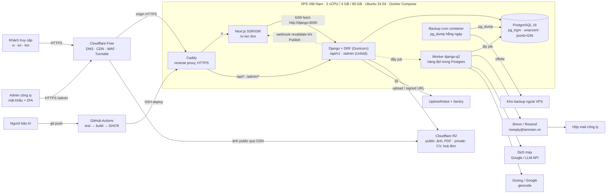
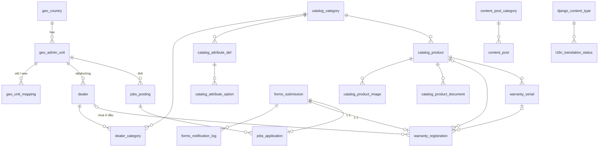
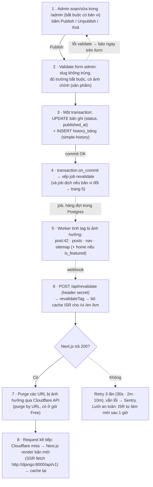
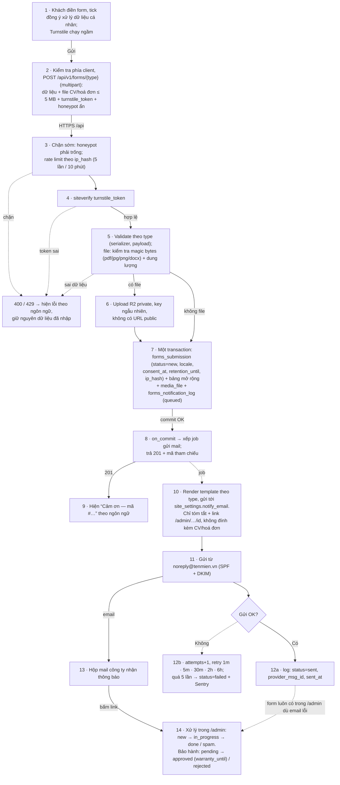
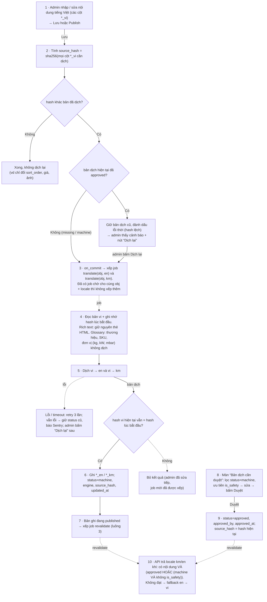

# ikura — Nội dung các diagram draw.io

> Chuyển nguyên nội dung từ [diagrams/ikura-backend.drawio](diagrams/ikura-backend.drawio) sang markdown. Đây là bản cuối ngày 28/09/2026, khôi phục ngày 22/10/2026.
> Mở file `.drawio` bằng app draw.io hoặc trang app.diagrams.net. File có 5 trang: 1 Kiến trúc · 2 ERD · 3 Publish → revalidate · 4 Form → DB → email · 5 Dịch máy vi → en/km.
> Plan tổng thể nằm ở [ikura-plan.md](ikura-plan.md).

**Ký hiệu chung trong các flow:**

| Ký hiệu | Nghĩa |
|---|---|
| ── mũi tên liền | Gọi đồng bộ (chờ kết quả) |
| - - mũi tên nét đứt | Bất đồng bộ (job trong hàng đợi / webhook) |
| - - nét đứt đỏ | Nhánh lỗi |
| ◇ | Điểm rẽ nhánh |

---

## Trang 1 — Kiến trúc

Monolith Django + Next.js chạy trên 1 VPS bằng Docker Compose. Ngôn ngữ vi / en / km. Địa lý là Việt Nam, đã chừa chỗ cho quốc gia khác.

**Chi tiết từng khối:**

| Khối | Chi tiết |
|---|---|
| VPS | 2 vCPU / 4 GB RAM / 80 GB SSD, Ubuntu 24.04 LTS, Docker Compose. UFW chỉ mở 80/443 cho IP Cloudflare, cộng SSH đăng nhập bằng key, không dùng mật khẩu |
| Cloudflare (Free) | DNS cho tên miền `.vn`; CDN cache trang và ảnh; WAF, chống DDoS; Turnstile chống spam form |
| Caddy | `/` chuyển tới nextjs; `/api/*` và `/admin/*` chuyển tới django |
| Next.js | `/vi` · `/en` · `/km`, có `sitemap.xml` và hreflang |
| Django + DRF | `/api/v1` (REST + OpenAPI); `/admin` (Django Admin, theme Unfold); import/export Excel; audit log bằng simple-history. Các app: catalog · geo · dealers · content · jobs · forms · warranty · i18n · site · media |
| Worker (django-q2) | Gửi email thông báo; resize / nén ảnh; geocode địa chỉ đại lý; dịch máy vi → en/km; chạy import Excel lớn |
| R2 | Bucket public chứa ảnh và PDF catalogue, phục vụ qua `media.<tenmien>.vn`. Bucket private chứa CV và hoá đơn, chỉ tải được bằng signed URL |
| Backup | `pg_dump` hằng ngày. Giữ bản 7 ngày · 4 tuần · 6 tháng. Đẩy sang bucket R2 riêng hoặc nhà cung cấp khác |
| Email | Brevo / Resend, gửi từ `noreply@<tenmien>.vn`, có SPF + DKIM |
| Bản đồ | Goong / Google. Trình duyệt tải tile trực tiếp; worker gọi geocode |
| Deploy | GitHub Actions: test → build image → GHCR → SSH vào VPS chạy `docker compose pull && up -d` |
| Người bảo trì | Có tài khoản admin riêng và SSH key |

**Ghi chú trên diagram:**

1. Mọi form lưu vào DB trước. Email chỉ là thông báo; gửi lỗi thì worker gửi lại.
2. Next.js gọi Django qua mạng Docker nội bộ. Trình duyệt chỉ gọi `/api` cho form, bộ lọc và tìm kiếm.
3. Không dùng Redis, search engine riêng hay microservice. Chỉ thêm khi có số liệu chứng minh là cần.
4. App không giữ trạng thái: file nằm ở R2, config truyền qua env. Nhờ vậy cần scale thì tách thêm server được.
5. Mỗi quý thử khôi phục backup ít nhất 1 lần.

---

## Trang 2 — Database (ERD)

**Quy ước:**

- `xxx_{vi,en,km}` nghĩa là 3 cột, mỗi cột một ngôn ngữ (django-modeltranslation).
- Mọi bảng nghiệp vụ có thêm bảng lịch sử `history_<bảng>` (django-simple-history: `history_user_id`, `history_date`, `history_type`).
- Khóa ngoại tới các bảng dùng chung (`auth_user`, `media_file`, `import_batch`) chỉ ghi tên bảng đích trong cột, không vẽ đường nối.

### GEO — Đơn vị hành chính

**geo_country**
| Cột | Kiểu / ghi chú |
|---|---|
| PK `id` | bigint |
| UQ `code` | char(2), ví dụ `'VN'` |
| `name_{vi,en,km}` | varchar |
| `is_active` | bool |

**geo_admin_unit**
| Cột | Kiểu / ghi chú |
|---|---|
| PK `id` | bigint |
| FK `country_id` | → geo_country |
| FK `parent_id` | → self, null |
| `level` | enum province \| district \| commune |
| UQ `code` | varchar, mã GSO |
| `name_{vi,en,km}` | varchar |
| `slug` | varchar |
| `valid_from` | date |
| `valid_to` | date null (null = đang hiện hành) |

**geo_unit_mapping** (ánh xạ đơn vị cũ sang mới sau 07/2025)
| Cột | Kiểu / ghi chú |
|---|---|
| PK `id` | bigint |
| FK `old_unit_id` | → geo_admin_unit |
| FK `new_unit_id` | → geo_admin_unit |
| `note` | varchar |

### DEALERS — Đại lý / điểm bán

**dealer**
| Cột | Kiểu / ghi chú |
|---|---|
| PK `id` | bigint |
| UQ `code` | varchar |
| `name` | varchar |
| `type` | enum dealer \| store \| service_center |
| FK `admin_unit_id` | → geo_admin_unit (cấp xã/phường) |
| `address_line` | varchar |
| `address_raw` | text, nguyên văn từ Excel |
| `lat`, `lng` | numeric(9,6) |
| `geocode_status` | enum auto \| manual \| failed |
| `phone`, `zalo_phone`, `email` | varchar |
| `opening_hours` | jsonb |
| `has_delivery` | bool |
| `is_active` | bool |
| `note` | text |
| FK `import_batch_id` | → import_batch, null |
| `created_at`, `updated_at` | timestamptz |

**dealer_category** (đại lý bán những danh mục nào)
| Cột | Kiểu / ghi chú |
|---|---|
| PK·FK `dealer_id` | → dealer |
| PK·FK `category_id` | → catalog_category |

### CATALOG — Sản phẩm (bếp ga · ga · thiết bị ga)

**catalog_category**
| Cột | Kiểu / ghi chú |
|---|---|
| PK `id` | bigint |
| FK `parent_id` | → self, null |
| UQ `slug` | varchar |
| `name_{vi,en,km}` | varchar |
| `description_{vi,en,km}` | text |
| FK `image_id` | → media_file, null |
| `sort_order` | int |
| `is_active` | bool |

**catalog_product**
| Cột | Kiểu / ghi chú |
|---|---|
| PK `id` | bigint |
| FK `category_id` | → catalog_category |
| UQ `sku` | varchar |
| UQ `slug` | varchar |
| `name_{vi,en,km}` | varchar, có trgm index |
| `short_desc_{vi,en,km}` | text |
| `description_{vi,en,km}` | rich text |
| `attributes` | jsonb, có GIN index |
| `price` | numeric null |
| `show_price` | bool |
| `warranty_months` | int |
| `is_featured` | bool |
| `is_active` | bool |
| `sort_order` | int |
| `seo_title_{vi,en,km}`, `seo_desc_{vi,en,km}` | varchar |
| FK `import_batch_id` | → import_batch, null |
| `created_at`, `updated_at` | timestamptz |

**catalog_attribute_def** (định nghĩa thuộc tính theo danh mục)
| Cột | Kiểu / ghi chú |
|---|---|
| PK `id` | bigint |
| FK `category_id` | → catalog_category |
| `key` | varchar, UQ(category_id, key) |
| `data_type` | enum text \| number \| bool \| enum \| multi_enum |
| `unit` | varchar null |
| `label_{vi,en,km}` | varchar |
| `is_filterable` | bool |
| `is_required` | bool |
| `sort_order` | int |

**catalog_attribute_option**
| Cột | Kiểu / ghi chú |
|---|---|
| PK `id` | bigint |
| FK `attribute_id` | → catalog_attribute_def |
| `value` | varchar |
| `label_{vi,en,km}` | varchar |
| `sort_order` | int |

**catalog_product_image**
| Cột | Kiểu / ghi chú |
|---|---|
| PK `id` | bigint |
| FK `product_id` | → catalog_product |
| FK `file_id` | → media_file |
| `alt_{vi,en,km}` | varchar |
| `is_primary` | bool |
| `sort_order` | int |

**catalog_product_document**
| Cột | Kiểu / ghi chú |
|---|---|
| PK `id` | bigint |
| FK `product_id` | → catalog_product |
| FK `file_id` | → media_file |
| `doc_type` | enum catalogue \| manual \| certificate |
| `title_{vi,en,km}` | varchar |
| `sort_order` | int |

### FORMS & WARRANTY — Liên hệ, đăng ký đại lý, bảo hành

**forms_submission** (bảng chung cho mọi form)
| Cột | Kiểu / ghi chú |
|---|---|
| PK `id` | bigint |
| `type` | enum contact \| dealer_signup \| warranty \| job_application |
| `locale` | enum vi \| en \| km |
| `full_name` | varchar |
| `phone` | varchar |
| `email` | varchar null |
| `message` | text |
| `payload` | jsonb, chứa trường riêng của từng form |
| `status` | enum new \| in_progress \| done \| spam |
| `consent_at` | timestamptz, thời điểm đồng ý xử lý dữ liệu cá nhân |
| `retention_until` | date |
| `ip_hash` | char(64) |
| FK `handled_by` | → auth_user, null |
| `handled_at` | timestamptz |
| `created_at` | timestamptz |

**forms_notification_log**
| Cột | Kiểu / ghi chú |
|---|---|
| PK `id` | bigint |
| FK `submission_id` | → forms_submission, null |
| `to_email` | varchar |
| `template` | varchar |
| `subject` | varchar |
| `status` | enum queued \| sent \| failed |
| `attempts` | int |
| `provider_msg_id` | varchar |
| `error` | text |
| `sent_at`, `created_at` | timestamptz |

**warranty_registration** (mở rộng 1-1 của forms_submission)
| Cột | Kiểu / ghi chú |
|---|---|
| PK·FK `submission_id` | → forms_submission (1-1) |
| FK `product_id` | → catalog_product, null |
| `serial_text` | varchar, nguyên văn khách nhập |
| FK `serial_id` | → warranty_serial, null |
| FK `dealer_id` | → dealer, null (nơi mua) |
| FK `admin_unit_id` | → geo_admin_unit, null |
| `address_line` | varchar |
| `purchase_date` | date |
| FK `invoice_file_id` | → media_file (bucket private) |
| `status` | enum pending \| approved \| rejected |
| `warranty_until` | date null |
| `admin_note` | text |

**warranty_serial** (dùng ở giai đoạn 2)
| Cột | Kiểu / ghi chú |
|---|---|
| PK `id` | bigint |
| UQ `serial` | varchar |
| FK `product_id` | → catalog_product |
| `batch_code` | varchar |
| `manufactured_at` | date null |
| FK `import_batch_id` | → import_batch |
| `note` | text |
| `created_at` | timestamptz |

### JOBS — Tuyển dụng

**jobs_posting**
| Cột | Kiểu / ghi chú |
|---|---|
| PK `id` | bigint |
| UQ `slug` | varchar |
| `title_{vi,en,km}` | varchar |
| `department` | varchar |
| FK `location_unit_id` | → geo_admin_unit (cấp tỉnh) |
| `employment_type` | enum full_time \| part_time \| intern |
| `salary_text_{vi,en,km}` | varchar |
| `description_{vi,en,km}`, `requirements_{vi,en,km}`, `benefits_{vi,en,km}` | rich text |
| `deadline` | date |
| `status` | enum draft \| published \| closed |
| `published_at` | timestamptz |
| `created_at`, `updated_at` | timestamptz |

**jobs_application** (mở rộng 1-1 của forms_submission)
| Cột | Kiểu / ghi chú |
|---|---|
| PK·FK `submission_id` | → forms_submission (1-1) |
| FK `job_posting_id` | → jobs_posting |
| FK `cv_file_id` | → media_file (bucket private) |
| `expected_salary` | varchar null |

### CONTENT — Tin tức, cẩm nang, trang tĩnh

**content_post_category**
| Cột | Kiểu / ghi chú |
|---|---|
| PK `id` | bigint |
| UQ `slug` | varchar |
| `name_{vi,en,km}` | varchar |
| `sort_order` | int |

**content_post**
| Cột | Kiểu / ghi chú |
|---|---|
| PK `id` | bigint |
| FK `category_id` | → content_post_category |
| UQ `slug` | varchar |
| `title_{vi,en,km}` | varchar |
| `excerpt_{vi,en,km}` | text |
| `body_{vi,en,km}` | rich text |
| FK `cover_file_id` | → media_file, null |
| `is_safety` | bool, cấm hiện bản dịch máy |
| `status` | enum draft \| published |
| `published_at` | timestamptz |
| `seo_title_{vi,en,km}`, `seo_desc_{vi,en,km}` | varchar |
| FK `author_id` | → auth_user |
| `created_at`, `updated_at` | timestamptz |

**content_page** (trang tĩnh)
| Cột | Kiểu / ghi chú |
|---|---|
| PK `id` | bigint |
| UQ `key` | varchar: about \| services \| warranty_policy \| privacy… |
| `title_{vi,en,km}` | varchar |
| `body_{vi,en,km}` | rich text |
| `seo_title_{vi,en,km}`, `seo_desc_{vi,en,km}` | varchar |
| `is_safety` | bool |
| `updated_at` | timestamptz |

### SYSTEM — Dùng chung

**auth_user** (Django built-in, cộng thêm `auth_group` tên 'Admin')
| Cột | Kiểu / ghi chú |
|---|---|
| PK `id` | bigint |
| UQ `username` | varchar |
| `email` | varchar |
| `password` | hash |
| `is_superuser`, `is_active` | bool |
| `last_login` | timestamptz |

**django_content_type** (Django built-in)
| Cột | Kiểu / ghi chú |
|---|---|
| PK `id` | int |
| `app_label` | varchar |
| `model` | varchar |

**media_file**
| Cột | Kiểu / ghi chú |
|---|---|
| PK `id` | bigint |
| UQ `storage_key` | varchar |
| `bucket` | enum public \| private |
| `mime_type` | varchar |
| `size_bytes` | bigint |
| `width`, `height` | int null |
| `checksum` | char(64), sha256 |
| FK `uploaded_by` | → auth_user |
| `created_at` | timestamptz |

**import_batch**
| Cột | Kiểu / ghi chú |
|---|---|
| PK `id` | bigint |
| `entity` | enum product \| dealer \| serial \| admin_unit |
| FK `file_id` | → media_file |
| `status` | enum preview \| committed \| failed \| rolled_back |
| `total_rows`, `ok_rows`, `error_rows` | int |
| `errors` | jsonb, lỗi theo từng dòng |
| FK `created_by` | → auth_user |
| `created_at`, `committed_at` | timestamptz |

**i18n_translation_status**
| Cột | Kiểu / ghi chú |
|---|---|
| PK `id` | bigint |
| FK `content_type_id` | → django_content_type |
| `object_id` | bigint |
| `locale` | enum en \| km |
| `status` | enum missing \| machine \| approved |
| `engine` | varchar null: google \| llm |
| `source_hash` | char(64), hash bản vi tại thời điểm dịch |
| FK `approved_by` | → auth_user, null |
| `approved_at`, `updated_at` | timestamptz |
| | UQ(content_type_id, object_id, locale) |

**site_settings** (chỉ có 1 dòng)
| Cột | Kiểu / ghi chú |
|---|---|
| PK `id` | int, luôn = 1 |
| `company_name_{vi,en,km}` | varchar |
| `hotline`, `emergency_hotline` | varchar |
| `notify_email` | varchar, mail công ty |
| `address_{vi,en,km}` | varchar |
| `facebook_url`, `zalo_url`, `telegram_url`, `youtube_url` | varchar |
| `map_center_lat`, `map_center_lng` | numeric |
| `updated_at` | timestamptz |

**site_section**
| Cột | Kiểu / ghi chú |
|---|---|
| PK `id` | int |
| UQ `key` | varchar: products \| services \| dealers \| news \| careers \| contact \| about |
| `is_enabled` | bool |
| `label_{vi,en,km}` | varchar |
| `sort_order` | int |

**seo_redirect**
| Cột | Kiểu / ghi chú |
|---|---|
| PK `id` | bigint |
| UQ `old_path` | varchar |
| `new_path` | varchar |
| `status_code` | smallint: 301 \| 302 |
| `hits` | int |
| `created_at` | timestamptz |

### Quan hệ (các đường nối vẽ trên diagram)

### Quy tắc dùng chung (ghi trên ERD)

- **Khi nào hiện một ngôn ngữ:** bản đó có nội dung, và `i18n_translation_status` là `approved`, hoặc là `machine` với điều kiện bản ghi không phải `is_safety`. Nếu không đạt, API fallback về en, rồi về vi.
- `source_hash` khác hash của bản vi hiện tại nghĩa là bản dịch đã lỗi thời. Admin sẽ thấy cảnh báo.
- **Menu:** một mục chỉ hiện khi `site_section.is_enabled` bật và có ít nhất 1 nội dung published ở ngôn ngữ đó. Nhờ vậy mục trống tự ẩn.
- **Rollback import:** xoá hoặc khôi phục theo `import_batch_id`.
- **Địa chỉ cũ** (trước 07/2025): tra `geo_unit_mapping` lúc import.
- **CV / hoá đơn:** khi quá `retention_until` thì xoá file và ẩn danh submission.

---

## Trang 3 — Luồng Publish → revalidate

**Áp dụng cho:** sản phẩm, danh mục, bài viết, trang tĩnh, tin tuyển dụng, đại lý, site_section.
Giai đoạn 1 chưa có hẹn giờ đăng.

**Các làn (swimlane):** Admin công ty · Django (Admin + API) · PostgreSQL · Worker (django-q2) · Next.js (ISR cache) · Cloudflare (CDN) · Khách truy cập.

**Ghi chú:**

1. Job revalidate chỉ được xếp sau khi commit, nên Next.js không bao giờ đọc phải dữ liệu cũ do race condition.
2. Dùng tag thay vì liệt kê path: 1 tag phủ cả 3 ngôn ngữ và mọi trang có liệt kê bản ghi đó. Tag `nav` làm mới menu, nên mục trống tự ẩn theo `site_section`.
3. Unpublish và Xoá đi cùng luồng này: trang chi tiết trả 404, bản ghi rời khỏi danh sách và sitemap. Đổi slug thì hệ thống tự tạo `seo_redirect` 301 từ slug cũ.
4. **Xem trước bản nháp:** nút Xem trước trong admin mở Next.js Draft Mode bằng token có ký, hết hạn sau 10 phút. Bản xem trước không đi qua cache Cloudflare và không làm bẩn ISR.
5. Secret của webhook revalidate và API token Cloudflare (chỉ có quyền Cache Purge) nằm trong env, không nằm trong DB.

---

## Trang 4 — Luồng Form → DB → email

**4 loại form:** Liên hệ · Đăng ký đại lý · Đăng ký bảo hành · Ứng tuyển.
**Nguyên tắc:** lưu DB trước, email chỉ là thông báo.

**Các làn:** Khách truy cập · Trang form (Next.js, trình duyệt) · Cloudflare Turnstile · Django API · PostgreSQL · R2 private · Worker (django-q2) · Brevo / Resend · Công ty (hộp mail + /admin).

**Ghi chú:**

1. Email lỗi không làm mất form: bản ghi đã nằm trong DB từ bước 7, nên admin luôn thấy nó trong danh sách "chưa xử lý".
2. Nếu khách có nhập email, hệ thống thêm 1 dòng `forms_notification_log` để gửi email xác nhận cho khách theo ngôn ngữ của họ, cùng cơ chế retry.
3. File CV và hoá đơn chỉ tải được qua `/admin` bằng signed URL hết hạn sau 5 phút. Email không bao giờ chứa file hay dữ liệu nhạy cảm.
4. **Job hằng ngày:** submission nào quá `retention_until` thì xoá file trên R2 và ẩn danh họ tên / SĐT / email. Số liệu thống kê vẫn giữ lại.
5. Bảo hành giai đoạn 1 chỉ có đăng ký: `serial_text` lưu nguyên văn, `serial_id` để trống. Tra cứu serial là việc của giai đoạn 2.
6. `ip_hash = sha256(IP + salt trong env)`. Cách này cho phép rate limit mà không cần lưu IP thật.

---

## Trang 5 — Luồng dịch máy vi → en / km

Bản vi là bản nguồn. Mỗi cặp (bản ghi, ngôn ngữ) có 1 dòng `i18n_translation_status`, trạng thái đi theo thứ tự `missing → machine → approved`.

**Các làn:** Admin công ty · Django Admin · PostgreSQL · Worker (django-q2) · Dịch máy (Google / LLM API) · API công khai + Next.js.

**Ghi chú:**

1. Không bao giờ ghi đè bản đã approved. Bản đã có người duyệt chỉ bị thay khi có người bấm "Dịch lại".
2. Nội dung `is_safety` (hướng dẫn an toàn gas, xử lý rò rỉ): bản dịch máy vẫn được lưu nhưng không hiện cho khách cho tới khi được duyệt. Trong lúc chưa duyệt, khách xem bản en hoặc vi.
3. **SEO:** hreflang và sitemap chỉ liệt kê những ngôn ngữ thực sự đang hiển thị. Trang đang fallback gắn canonical về bản gốc để tránh nội dung trùng lặp.
4. **Chi phí:** chỉ dịch khi hash đổi, và gộp các job trùng. Nhờ vậy sửa vặt nhiều lần vẫn chỉ tốn 1 lượt dịch cho mỗi ngôn ngữ.
5. Engine (Google / LLM) chọn qua env và được ghi vào cột `engine`, để sau này so sánh chất lượng tiếng Khmer.
